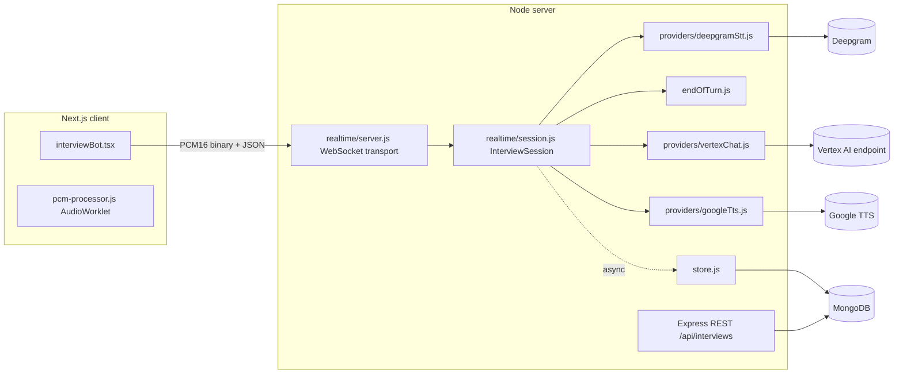

# Architecture (current state)

Describes what exists today. Planned modules are listed in [implementation-status.md](implementation-status.md), not here.

## Layout

| Path | Responsibility |
| --- | --- |
| `server/index.js` | Express app, GCP credential bootstrap, starts the realtime server, `/api/metrics` |
| `server/realtime/server.js` | WebSocket transport only: origin check, `hello`/resume, validation, rate limit, heartbeat, session registry and sweeper |
| `server/realtime/session.js` | Interview logic: turn states, queue, idempotency, interruption, STT handling, persistence scheduling |
| `server/realtime/endOfTurn.js` | End-of-turn detection (pure, timer-based) |
| `server/realtime/providers/*` | External APIs behind small interfaces (`complete`, `synthesize`, `open`), each with timeouts |
| `server/realtime/store.js` | MongoDB and in-memory persistence implementations |
| `server/realtime/{config,messages,metrics,logger,sessionToken,util,prompt}.js` | Config, message validation, latency stats, JSON logs, resume tokens, timeout/retry helpers, prompt text |
| `server/models/*` | Mongoose models (`Interview`, `InterviewSession`) |
| `client/src/app/components/interviewBot.tsx` | Live interview UI and socket client |

Provider objects are injected (`createRealtimeServer({ deps })`), which is what lets the integration tests run the real transport and session code against fakes.

## Audit findings (verified in source before changes)

Fixed in this change:

- Fixed 5 s client-side debounce before sending an answer (`SILENCE_DURATION`/`setTimeout(…, 5000)`); Deepgram `speech_final`/`UtteranceEnd` ignored. Now server-side, configurable.
- No turn identity: replies could not be matched to answers; duplicates/overlaps ran concurrently. Now `turnId`, idempotency, serialization.
- Session identity was client-chosen (`session_<timestamp>` in `localStorage`); any client could resume any known id. Now server-issued ids plus signed resume tokens.
- No WebSocket authentication, origin check, payload limit or message validation; message contents (`console.log(data)`) and full Deepgram payloads were logged.
- No timeouts on Vertex/TTS calls; result parsing used two different paths (`predictions.choices` vs `predictions[0].choices`), with a canned reply on parse failure hiding errors.
- MongoDB write was awaited before TTS.
- Vertex project/endpoint IDs hardcoded in source; service-account key rewritten to disk on every request.
- Reconnect: the client retried every 5 s forever (even after unmount/end of interview) and deleted its session on every close.
- Bot audio was decoded with the same `AudioContext` used for 16 kHz capture, which `cleanup()` closes.
- First-turn persistence could fail Mongoose validation (empty user `content`).
- `Interview.difficulty` default (`"medium"`) was not in its own enum; `createdDate` default was evaluated once at load.
- Server rate limiter read `parseInt(undefined)` → `NaN` when env vars were unset.

Still open (not addressed here):

- REST API has no authentication or authorization; `GET /api/interviews` lists everything; `create-interview` validates `interviewDate/Time` that the schema drops.
- `xss-clean` is unmaintained; `multer-s3`, `aws-sdk` v2, `cloudinary`, `razorpay`, `openai`, `@google/genai` etc. are declared but unused by the code reviewed.
- `server/flux.js` is a standalone Deepgram experiment, not part of the app.
- The client UI contains placeholder elements (hardcoded participant badge "2", static "Y" avatar, non-functional video/screen-share buttons).
- Session recording is downloaded in the browser on stop; nothing is uploaded.
- Interview transcripts have no retention limit (only an index on `expiresAt`; no TTL deletion).
