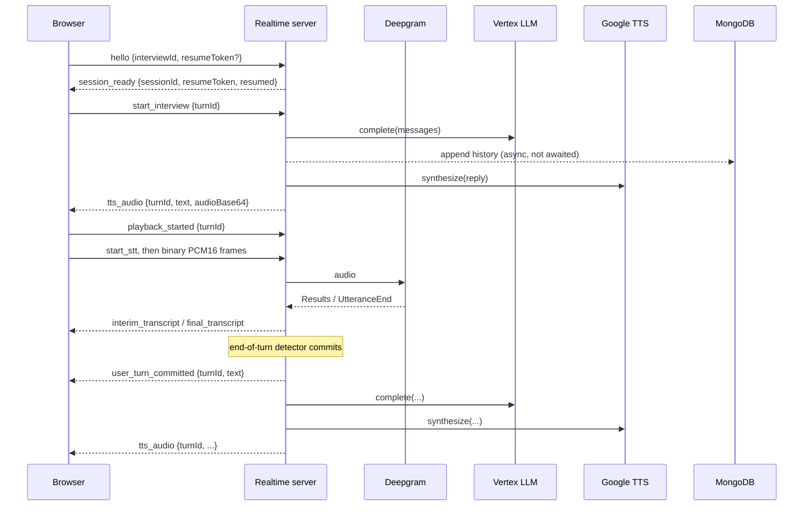

# Voice interview lifecycle and WebSocket protocol

## States

Turn: `queued → llm → tts → delivered`, or `undelivered` (reply ready, socket gone), `cancelled`, `failed`.
Session: `active → ended`. A session outlives its socket for `WS_RECOVERY_WINDOW_MS`.

## Client → server

| `type` | Fields | Notes |
| --- | --- | --- |
| `hello` | `interviewId`, `resumeToken?` | Must be first; otherwise `NOT_AUTHENTICATED`. No hello within `WS_HELLO_TIMEOUT_MS` closes with 4001. |
| `start_interview` | `turnId` | Greeting turn |
| `user_turn` | `turnId`, `text` | Typed/explicit answer. Same `turnId` is processed once; completed duplicates replay the reply; failed/cancelled ones re-run. |
| `start_stt` / `stop_stt` | – | `stop_stt` is the manual end-of-turn |
| binary frame (or `audio_chunk` + `audioBase64`) | PCM16 mono 16 kHz | Exempt from the control-message rate limit |
| `interrupt` | – | Cancels in-flight turn, drops queued turns |
| `playback_started` | `turnId` | Used to measure send→playback latency |
| `end_interview`, `ping` | – | |

`turnId` must match `[A-Za-z0-9_-]{8,64}`. Text ≤ `WS_MAX_TEXT_CHARS`; frames ≤ `WS_MAX_PAYLOAD_BYTES` (larger closes with 1009).

## Server → client

`session_ready`, `turn_state`, `tts_audio {turnId,text,audioBase64|null,ttsError?}`, `turn_cancelled`, `user_turn_committed {turnId,text,reason}`, `stt_started`, `interim_transcript`, `final_transcript`, `speech_started`, `session_ended`, `stt_error`, `pong`, and `error {code, message, turnId?, retryable?}`.

Error codes: `INVALID_JSON`, `INVALID_MESSAGE`, `UNKNOWN_TYPE`, `PAYLOAD_TOO_LARGE`, `RATE_LIMITED`, `NOT_AUTHENTICATED`, `INTERVIEW_NOT_FOUND`, `INVALID_RESUME_TOKEN`, `SESSION_EXPIRED`, `SESSION_ENDED`, `BUSY`, `LLM_TIMEOUT`, `LLM_UPSTREAM`, `LLM_EMPTY`, `LLM_CONFIG`, `LLM_FAILED`, `TURN_TIMEOUT`, `STT_NOT_CONFIGURED`, `STT_FAILED`. Messages are generic; provider detail goes to server logs only.

## End-of-turn strategy

Deepgram is opened with `endpointing`, `utterance_end_ms` and `vad_events`. Final fragments are buffered and committed on the earliest of:

1. `UtteranceEnd` (+ `EOT_UTTERANCE_END_GRACE_MS`, default 0)
2. a `speech_final` fragment followed by `EOT_SPEECH_FINAL_GRACE_MS` (default 1200) with no new speech
3. `EOT_FALLBACK_MS` (default 3000) after the last final fragment
4. manual `stop_stt` (finalize, then commit after the Finalize reply or `EOT_MANUAL_STOP_WAIT_MS`)
5. STT stream closing or the client disconnecting (nothing the candidate said is dropped)

Any interim/final speech cancels a pending commit. **The defaults are untuned starting points**; they have not been evaluated against real candidates.

## Recovery

`session_ready` carries a signed `resumeToken` (session id + interview id, `WS_RESUME_TOKEN_TTL_SEC`). After a drop the client reconnects with exponential backoff and sends the token; the server reattaches the in-memory session or rebuilds it from MongoDB (history only) if not expired. Replies that completed while disconnected are replayed. A newer connection closes the older one (4000). STT is not resumed automatically; the client restarts it.

## Streaming: investigated, not implemented

Responses are generated and synthesized as complete units and decoded in full before playback. A streaming path was not added because: the Vertex dedicated-endpoint request format in use (`:predict` with `chatCompletions`) is non-streaming, and I could not verify a supported streaming variant or TTS streaming path against real credentials in this environment. Replies are capped at about 20 words, which bounds the benefit. The buffered path is the only path.
