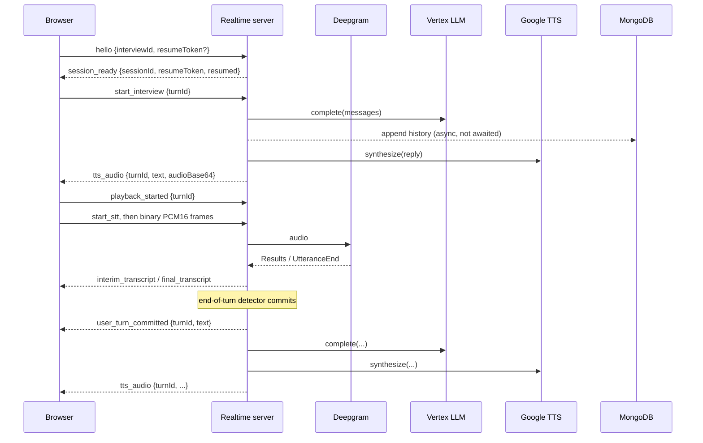
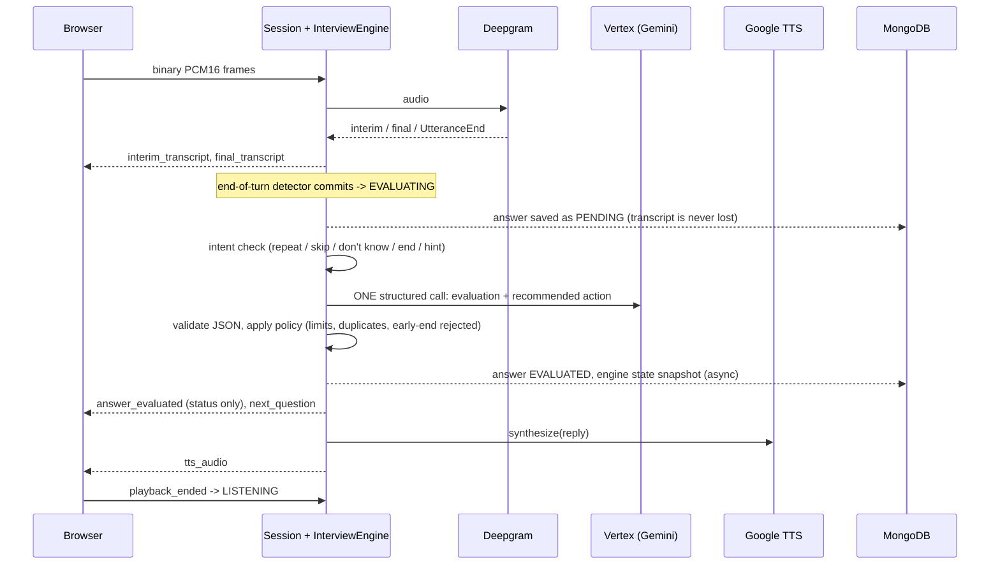

# Voice interview lifecycle and WebSocket protocol

## States

Turn: `queued → llm → tts → delivered`, or `undelivered` (reply ready, socket gone), `cancelled`, `failed`.
Session: `active → ended`. A session outlives its socket for `WS_RECOVERY_WINDOW_MS`.

## Client → server

| `type` | Fields | Notes |
| --- | --- | --- |
| `hello` | `interviewId`, `resumeToken?` | Must be first; otherwise `NOT_AUTHENTICATED`. No hello within `WS_HELLO_TIMEOUT_MS` closes with 4001. |
| `start_interview` | `turnId` | Greeting turn |
| `user_turn` | `turnId`, `text` | Typed/explicit answer. Same `turnId` is processed once; completed duplicates replay the reply; failed/cancelled ones re-run. |
| `start_stt` / `stop_stt` | – | `stop_stt` is the manual end-of-turn |
| binary frame (or `audio_chunk` + `audioBase64`) | PCM16 mono 16 kHz | Exempt from the control-message rate limit |
| `interrupt` | – | Cancels the in-flight generation and drops queued turns; the cancelled answer's text is carried into the next answer |
| `playback_started` | `turnId` | Used to measure send→playback latency |
| `end_interview`, `ping` | – | |

`turnId` must match `[A-Za-z0-9_-]{8,64}`. Text ≤ `WS_MAX_TEXT_CHARS`; frames ≤ `WS_MAX_PAYLOAD_BYTES` (larger closes with 1009).

## Server → client

`session_ready`, `turn_state`, `tts_audio {turnId,text,audioBase64|null,ttsError?}`, `turn_cancelled`, `user_turn_committed {turnId,text,reason}`, `stt_started`, `interim_transcript`, `final_transcript`, `speech_started`, `session_ended`, `stt_error`, `pong`, and `error {code, message, turnId?, retryable?}`.

Error codes: `INVALID_JSON`, `INVALID_MESSAGE`, `UNKNOWN_TYPE`, `PAYLOAD_TOO_LARGE`, `RATE_LIMITED`, `NOT_AUTHENTICATED`, `INTERVIEW_NOT_FOUND`, `INVALID_RESUME_TOKEN`, `SESSION_EXPIRED`, `SESSION_ENDED`, `BUSY`, `LLM_TIMEOUT`, `LLM_UPSTREAM`, `LLM_EMPTY`, `LLM_CONFIG`, `LLM_FAILED`, `TURN_TIMEOUT`, `STT_NOT_CONFIGURED`, `STT_FAILED`. Messages are generic; provider detail goes to server logs only.

## End-of-turn strategy

Deepgram is opened with `endpointing`, `utterance_end_ms` and `vad_events`. Final fragments are buffered and committed on the earliest of:

1. `UtteranceEnd` (+ `EOT_UTTERANCE_END_GRACE_MS`, default 0)
2. a `speech_final` fragment followed by `EOT_SPEECH_FINAL_GRACE_MS` (default 1200) with no new speech
3. `EOT_FALLBACK_MS` (default 3000) after the last final fragment
4. manual `stop_stt` (finalize, then commit after the Finalize reply or `EOT_MANUAL_STOP_WAIT_MS`)
5. STT stream closing or the client disconnecting (nothing the candidate said is dropped)

Any interim/final speech cancels a pending commit. **The defaults are untuned starting points**; they have not been evaluated against real candidates.

## Recovery

`session_ready` carries a signed `resumeToken` (session id + interview id, `WS_RESUME_TOKEN_TTL_SEC`). After a drop the client reconnects with exponential backoff and sends the token; the server reattaches the in-memory session or rebuilds it from MongoDB (history only) if not expired. Replies that completed while disconnected are replayed. A newer connection closes the older one (4000). STT is not resumed automatically; the client restarts it.

## Streaming: investigated, not implemented

Responses are generated and synthesized as complete units and decoded in full before playback. A streaming path was not added because: the Vertex dedicated-endpoint request format in use (`:predict` with `chatCompletions`) is non-streaming, and I could not verify a supported streaming variant or TTS streaming path against real credentials in this environment. Replies are capped at about 20 words, which bounds the benefit. The buffered path is the only path.

## Interview engine (structured mode, default)

Set `INTERVIEW_ENGINE=freeform` to restore the legacy prompt-only interviewer. Code: `server/realtime/interview/`.

**Principle: Deepgram decides what was said; the model *recommends*; the backend validates and decides; TTS speaks.**

**Conversation states** (`states.js`): `INITIALIZING → AI_SPEAKING → LISTENING → TRANSCRIBING → EVALUATING → DECIDING_NEXT_ACTION → AI_SPEAKING … → COMPLETED` (`FAILED` is reserved; a failed turn returns to `LISTENING`). Invalid transitions are rejected and counted (`conversation.invalid_transition`). At most one answer is ever being processed per session: a newer answer supersedes an unfinished one (see "Turn-taking, cancellation and races"), so two operations cannot advance one interview. In-flight states are not restored after a restart; the session comes back as `LISTENING` on the persisted current question.

**What the model does:** one call per answer returns `{evaluation, decision, summary}` (JSON mode, validated by `analysis.js`: closed enums, clamped score, bounded lists). A second call generates a new main question only when needed (skip, don't-know, follow-up limit reached, duplicate). Hints and "explain the question" use a short plain-text call. Candidate text is passed as JSON data, never as instructions.

**What the backend decides** (`policy.js`, pure and unit-tested): follow-ups per question (`INTERVIEW_MAX_FOLLOWUPS`, default 2), clarifications, repeats, question budget, time budget (`Interview.timeLimit`), duplicate-question rejection (token overlap; a heavy paraphrase is **not** caught), and difficulty (one step at a time from the mean of the last 3 scores, never from a single answer). The model **cannot end the interview early**; an `END_INTERVIEW` recommendation with questions remaining is overridden.

**Candidate intents** (`intents.js`, rule-based, short utterances only): repeat, explain, hint (once per question), skip (recorded, unscored), "I don't know" (scored 0), end (asks for confirmation first). Plain "yes"/"no" are answers unless an end-confirmation is pending.

**Failure behaviour:** malformed model output twice → the answer is stored as `EVALUATION_FAILED` and the candidate is asked to say more (never a fake score). A provider failure/timeout → the usual `error` event; the answer stays stored; the same `turnId` can be retried. Interview state is committed only when the whole turn succeeds.

### New events

| Direction | `type` | Fields |
| --- | --- | --- |
| client → server | `playback_ended` | `turnId` (moves `AI_SPEAKING → LISTENING`) |
| server → client | `interview_state` | `state`, `previous`, `reason` |
| server → client | `answer_evaluated` | `turnId`, `questionId`, `status` (`EVALUATED`, `CLARIFICATION_REQUESTED`, `EVALUATION_FAILED`). **No score or feedback.** |
| server → client | `next_question` | `questionId`, `questionType` (`MAIN`/`FOLLOW_UP`/`WARMUP`), `mainIndex`, `totalMain` |
| server → client | `interview_completed` | `reason` |
| server → client | `session_ready` | now also `completed`, `conversationState` |

The existing message names were kept (not renamed to the `INTERVIEW_START` / `AUDIO_CHUNK` style, and no `eventId`/`sequence` envelope) to avoid breaking the working client; see Known limitations.

### MongoDB

- `InterviewSession`: + `engineState` (small snapshot: current question, counters, rolling summary, last 50 asked questions), `conversationState`, `completedAt`.
- `InterviewAnswer` (new): one per answered turn, unique on `(sessionId, turnId)` so a replay can never create a second record or evaluation. Stores the question text/type/parent, transcript, status and evaluation. This replaces a separate `InterviewQuestion` collection: the question is small, immutable and always read with its answer.
- `InterviewEvaluation` (new): deterministic final result (overall and per-topic scores, strengths, weaknesses, recommendations) built from stored answers when the interview completes or the candidate ends it. Failed, skipped and clarified answers are excluded, not counted as zero.

### Config

`INTERVIEW_ENGINE`, `INTERVIEW_MAX_QUESTIONS` (5), `INTERVIEW_MAX_FOLLOWUPS` (2), `INTERVIEW_MAX_CLARIFICATIONS` (1), `INTERVIEW_MAX_REPEATS` (2), `INTERVIEW_HISTORY_WINDOW` (6), `INTERVIEW_*_MAX_TOKENS`. See `.env.example`.

### Known limitations

- **Streaming TTS** and chunked audio playback are not implemented (replies are ~one sentence; unchanged from before).
- **No `eventId`/`sequence` envelope** and no `PAUSE/RESUME/SKIP/REPEAT` client events; skip/repeat/end work through spoken intents. Pause is not implemented.
- **Barge-in** on the client already existed (speech while the AI plays stops playback and sends `interrupt`); there is no extra noise gate beyond Deepgram's VAD. If the candidate interrupts after the engine has already advanced, the engine considers the new question asked.
- Resume after a **server restart** restores the interview position, not an audio stream in progress; an answer being spoken at that moment is lost and the candidate is simply listening again. Replies that finished while disconnected are replayed only while the session is still in memory.
- No circuit breaker around Vertex; retries are bounded (`LLM_RETRIES`) with timeouts.
- Answer `duration` is not recorded. No resume-based question generation (no resume data exists in the project). No audio recording storage was added.
- Real-credential check performed once (see implementation-status); the audio path (mic → Deepgram → TTS) was **not** exercised.

## Turn-taking, cancellation and races

**Rule:** the AI and the candidate never talk over each other, and a late result can never change the interview.

### Generations
Every AI reply is produced by a *generation* with its own `generationId` (`gen_<uuid>`) and `AbortController`. `generationId` is sent on `turn_state`, `tts_audio`, `turn_cancelled`, `answer_evaluated`, `next_question` and `error`, and the client echoes it on `playback_started` / `playback_ended`. A generation is "current" only while it is the session's running generation, is not aborted, and the session is active.

### The commit point
A generation changes **nothing** until one synchronous commit point, reached only after the LLM **and** TTS have both finished while it is still current: engine state, conversation history, the evaluation writes to MongoDB and the engine snapshot are applied there (`InterviewSession._commitTurn`, `InterviewEngine` `outcome.commit()`), then the reply is sent. There is no `await` between the final currency check and the commit, so an abort cannot slip in. Consequence: a cancelled, superseded, timed-out or ended generation leaves the interview state and database exactly as they were; whatever arrives late is discarded. The one write made early is the candidate's own transcript (status `PENDING`), because it is user input, not a result of the generation.

### Superseding answers (instead of a queue)
A new answer while one is unfinished aborts the old generation and **merges** the old text in front of the new (`"first" + "second"` is evaluated once, as one answer), so nothing the candidate said is dropped. The old answer is stored as `SUPERSEDED` (`supersededBy` = the new turn). `interrupt` behaves the same way: the cancelled answer's text is carried into the next answer. A greeting cannot start while another turn is active (`BUSY`). A duplicate `turnId` is idempotent as before. The candidate turn lifecycle (`interview/candidateTurn.js`) is `IDLE → RECORDING → TRANSCRIBING → ANSWER_FINALIZED → EVALUATING → COMPLETED` (or `CANCELLED`), and it throws if a second turn is finalized while one is active.

### Strict turn-taking (default) and barge-in
- `INTERVIEW_BARGE_IN=false` (default): while the AI holds the floor (`AI_SPEAKING`) the server **ignores** microphone frames and STT events (`audio.rejected_ai_speaking`, `stt.ignored_while_ai_speaking`), even from a misbehaving client. The client mutes the track and stops sending. The microphone stays live while the AI is *thinking*, so a candidate who keeps talking is merged into their answer.
- `INTERVIEW_BARGE_IN=true`: the mic stays live, the candidate can interrupt; the client should rely on echo cancellation. The server announces the mode in `session_ready.bargeIn`; the client follows it.
- The AI keeps the floor until the **client** sends `playback_ended` for that reply and generation. A report for any other reply is stale and ignored (`playback.stale_ack`). If no report arrives within `INTERVIEW_PLAYBACK_ACK_TIMEOUT_MS` (30 s) the floor returns to the candidate (`playback.ack_timeout`). A reconnect also returns the floor, because the old audio is gone.
- Rapid repeated `start_stt` calls are idempotent (re-acknowledged, one Deepgram stream); a stop followed by a start reopens it.

### What "cancel" really does at each hop
| Hop | Mechanism | Does the upstream work stop? |
| --- | --- | --- |
| Browser audio | Playback stopped, stale replies rejected by the turn machine | Yes (local) |
| Orchestrator | Generation invalidated, `AbortController` aborted, all awaits raced against the signal (`raceAbort`) so the turn unwinds immediately | Yes (local) |
| Vertex (axios) | The HTTP request is aborted with the signal | The connection is closed; **whether Google stops computing is not known or guaranteed** |
| Google TTS (`@google-cloud/text-to-speech` 6.3 / `google-gax` 5.0) | No `AbortSignal` support and no `cancel()` on the returned promise (checked in this repo). The call is **not terminated**; the generation is invalidated and its audio is ignored when it arrives | **No** |

### Race scenarios and where they are tested (`server/__tests__/cancellation.test.js`)
1. LLM finishes just before the abort / TTS keeps running after cancel / TTS audio arrives after a new question started: late audio discarded, nothing committed.
2. LLM returns after cancellation (including an LLM that ignores the signal): the new turn is not blocked, the stale result changes nothing.
3. Candidate speaks while the AI speaks: ignored (strict) or accepted (barge-in).
4. Rapid mic/`start_stt` events and five answers in a burst: one stream, one reply to the combined answer.
5. Socket drops during cancellation: only the newest reply is replayed on resume.
6. Interview ends with an LLM or a TTS call pending: no state change, no history, no late messages.
7. Playback ack for an older reply, or with the wrong generation, arrives after the backend moved on: ignored.
8. An old response tries to overwrite a newer one: it cannot, by the commit point.

### Client
`client/src/features/interview/`: `interviewTurnMachine.ts` (pure reducer: `IDLE / AI_SPEAKING / LISTENING / PROCESSING / CANCELLED`, stale-reply and stale-ack rejection, mic mute and auto-listen rules) and `microphoneController.ts` (single capture, concurrent-start guard, stop-cancels-a-pending-start, gate that mutes the track, device-lost handling, full cleanup). `interviewBot.tsx` renders from them; the turn phase is shown under "AI Interviewer".

### Known limits of this design
- Replies are single complete MP3 responses, so there are no audio *chunks* to order: chunk ordering/buffering only becomes relevant if streaming TTS is added. Stale-reply rejection, playback acknowledgement and cleanup are implemented.
- A reply cancelled by an interrupt *after* it was committed and delivered cannot be un-asked; the interview has already moved on.
- If the candidate keeps speaking and a buffered utterance commits just after the AI started speaking (strict mode), it is processed as a new answer to the new question (counted in `turn.committed_while_ai_speaking`).
- A failed (not cancelled) answer is not carried forward; the transcript stays stored as `EVALUATION_FAILED`.
- The browser microphone/AudioWorklet path, auto-listening and the turn phase display were **not exercised in a real browser** (no Deepgram key; mic access).
